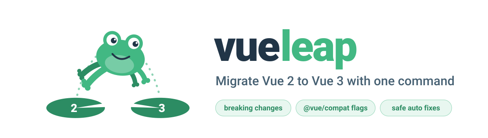
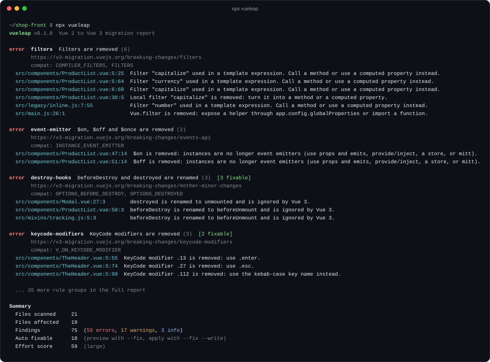

<p align="center">
  <picture>
    <source media="(prefers-color-scheme: dark)" srcset="assets/banner-dark.svg">
    
  </picture>
</p>

<h1 align="center">vueleap: migre do Vue 2 para o Vue 3 com um comando</h1>

<p align="center">
  <a href="https://www.npmjs.com/package/vueleap"></a>
  <a href="https://github.com/kwy404/vueleap/actions/workflows/ci.yml"></a>
  <a href="LICENSE"></a>
  <a href="package.json"></a>
</p>

<p align="center">
  <a href="README.md">Read in English</a> &middot;
  <a href="https://kwy404.github.io/vueleap/">Documentação</a> &middot;
  <a href="https://kwy404.github.io/vueleap/report-example.html">Relatório de exemplo</a>
</p>

**Descubra tudo o que quebra ao migrar do Vue 2 para o Vue 3, com um único comando.** O vueleap é uma ferramenta gratuita e open source de migração para o Vue 3: ele analisa um projeto Vue 2 e lista cada breaking change do Vue 3 arquivo por arquivo e linha por linha, explica cada uma com um link para o guia oficial de migração, mostra exatamente quais flags do `@vue/compat` o seu projeto precisa e aplica correções automáticas seguras.

```bash
npx vueleap
```

<p align="center">
  
</p>

## Sumário

- [Como verificar o que quebra na migração do Vue 2 para o Vue 3?](#como-verificar-o-que-quebra-na-migração-do-vue-2-para-o-vue-3)
- [O que o vueleap verifica?](#o-que-o-vueleap-verifica)
- [Quais correções são automáticas?](#quais-correções-são-automáticas)
- [Quais flags do @vue/compat meu projeto precisa?](#quais-flags-do-vuecompat-meu-projeto-precisa)
- [Como usar no CI?](#como-usar-no-ci)
- [Posso usar pelo Node.js?](#posso-usar-pelo-nodejs)
- [Perguntas frequentes](#perguntas-frequentes)
- [Licença](#licença)

## Como verificar o que quebra na migração do Vue 2 para o Vue 3?

Rode o vueleap na raiz do projeto Vue 2. Sem instalação e sem configuração:

```bash
npx vueleap                      # relatório do diretório atual
npx vueleap --html report.html   # também gera um relatório HTML
npx vueleap --fix                # mostra as correções seguras como diff
npx vueleap --fix --write        # aplica as correções
```

O comando `vue2to3` também é instalado como alias.

O vueleap lê componentes `.vue` (template, `<script>`, `<script setup>`, `<style>`), arquivos JavaScript, TypeScript, JSX, TSX, CSS, SCSS, Less e Stylus, além do `package.json`. Ele respeita o `.gitignore`, sempre ignora `node_modules` e `dist` e nunca segue links simbólicos. Templates Pug são ignorados com um aviso.

<p align="center">
  
</p>

| Opção | Descrição |
| --- | --- |
| `--json` | Relatório em JSON |
| `--html <arquivo>` | Gera um relatório HTML independente |
| `--fix` | Mostra as correções automáticas como diff (nada é gravado) |
| `--write` | Com `--fix`, grava as correções |
| `--fail-on <nível>` | Sai com código 1 se houver achados de nível `error`, `warning` ou `info` |
| `--compat` | Mostra apenas a configuração do `@vue/compat` |
| `--rule <id>` / `--skip-rule <id>` | Executa ou ignora regras específicas |
| `--ignore <padrão>` | Padrão extra de ignore (sintaxe do `.gitignore`) |
| `--list-rules` | Lista todas as regras |

## O que o vueleap verifica?

41 regras baseadas no [guia oficial de migração do Vue 3](https://v3-migration.vuejs.org/breaking-changes/). **error** quebra na compilação ou em execução, **warning** muda o comportamento e **info** merece revisão. A tabela completa, com descrições em inglês, está no [README em inglês](README.md#what-does-vueleap-check) e no [checklist de breaking changes](https://kwy404.github.io/vueleap/vue-3-breaking-changes-checklist.html).

Principais verificações: filters, `$listeners`, `$scopedSlots`, event bus com `$on`/`$off`/`$once`, `$set` e `$delete`, `new Vue()` e a API global (`Vue.component`, `Vue.use`, `Vue.mixin`, `Vue.directive`, `Vue.prototype`), `Vue.extend`, `beforeDestroy` e `destroyed`, hooks de diretivas customizadas, `v-model` em componentes, `.sync`, `.native`, modificadores keyCode, componentes funcionais, `inline-template`, `<template v-for>` com `key` nos filhos, `v-if` com `v-for`, ordem do `v-bind="obj"`, classes de transição, render functions com `h`, `data` como objeto, watchers de arrays, `Vue.config`, além de vue-router 3, Vuex 3 e bibliotecas só para Vue 2 (BootstrapVue, Vuetify 2, Element UI e outras) no `package.json`.

## Quais correções são automáticas?

Apenas reescritas com exatamente o mesmo significado no Vue 3, preservando a formatação:

| Regra | Antes | Depois |
| --- | --- | --- |
| `destroy-hooks` | `beforeDestroy()`, `destroyed()` | `beforeUnmount()`, `unmounted()` |
| `directive-hooks` | `bind`, `inserted`, `componentUpdated`, `unbind` | `beforeMount`, `mounted`, `updated`, `unmounted` |
| `scoped-slots` | `this.$scopedSlots.default` | `this.$slots.default` |
| `transition-classes` | `.fade-enter`, `.v-leave`, `enter-class` | `.fade-enter-from`, `.v-leave-from`, `enter-from-class` |
| `keycode-modifiers` | `@keyup.13` | `@keyup.enter` |
| `sync-modifier` | `:title.sync="doc.title"` | `v-model:title="doc.title"` |
| `hook-events` | `@hook:mounted` | `@vue:mounted` |
| `config-production-tip` | `Vue.config.productionTip = false` | (linha removida) |

Por padrão nada é gravado: `--fix` mostra um diff e só `--fix --write` altera arquivos, sempre dentro da pasta do projeto.

## Quais flags do @vue/compat meu projeto precisa?

O [migration build](https://v3-migration.vuejs.org/migration-build) (`@vue/compat`) roda código Vue 2 no Vue 3. O vueleap associa cada achado à sua flag e gera a configuração mínima: comportamento do Vue 3 por padrão (`MODE: 3`) e apenas as flags que o código ainda usa.

```bash
npx vueleap --compat
```

As flags de runtime vão para `configureCompat()` e as flags do compilador de templates (`COMPILER_*`) vão para `compilerOptions.compatConfig` do plugin do Vite ou do vue-loader. Veja [@vue/compat build flags explained](https://kwy404.github.io/vueleap/vue-compat-build-flags.html).

## Como usar no CI?

```yaml
- run: npx vueleap --fail-on error --html vueleap-report.html
```

`--json` gera um relatório legível por máquina para dashboards e verificações próprias.

## Posso usar pelo Node.js?

```ts
import { analyze, fix } from 'vueleap'

const result = await analyze('./meu-app-vue2')
console.log(result.summary, result.effort, result.compat)

const { files } = await fix('./meu-app-vue2', { write: false })
```

## Perguntas frequentes

### Quanto tempo leva uma migração do Vue 2 para o Vue 3?

Depende do uso de APIs removidas e de bibliotecas só para Vue 2. O `npx vueleap` termina com uma **pontuação de esforço**: cada achado soma o peso da sua regra, e achados com correção automática contam um décimo. Como referência aproximada, um ponto é cerca de uma hora de trabalho focado, mas a pontuação serve melhor para comparar projetos e acompanhar o progresso.

### Devo usar o @vue/compat?

Para apps médios e grandes, normalmente sim: o app roda no Vue 3 enquanto o código é convertido aos poucos. É uma ferramenta de transição, não de longo prazo. Apps pequenos costumam ser migrados mais rápido diretamente.

### O Vue 2 ainda tem suporte?

Não. O Vue 2 chegou ao fim da vida (end of life) em **31 de dezembro de 2023** e não recebe mais atualizações do time do Vue, nem correções de segurança. Veja [Vue 2 end of life](https://kwy404.github.io/vueleap/vue-2-end-of-life.html).

## Guias

- [How to migrate Vue 2 to Vue 3](https://kwy404.github.io/vueleap/migrate-vue-2-to-vue-3.html)
- [Vue 3 breaking changes checklist](https://kwy404.github.io/vueleap/vue-3-breaking-changes-checklist.html)
- [@vue/compat build flags explained](https://kwy404.github.io/vueleap/vue-compat-build-flags.html)
- [Vue filters removed in Vue 3](https://kwy404.github.io/vueleap/vue-filters-removed-vue-3.html)
- [Event bus in Vue 3](https://kwy404.github.io/vueleap/vue-event-bus-vue-3.html)
- [v-model changes in Vue 3](https://kwy404.github.io/vueleap/v-model-changes-vue-3.html)
- [Vue 2 end of life](https://kwy404.github.io/vueleap/vue-2-end-of-life.html)

## Contribuindo

Issues e pull requests são bem-vindos. Veja o [CONTRIBUTING.md](CONTRIBUTING.md) (em inglês) para saber como adicionar uma regra.

## Licença

[MIT](LICENSE) &copy; 2026 [Alexandre Kohler](https://github.com/kwy404)
